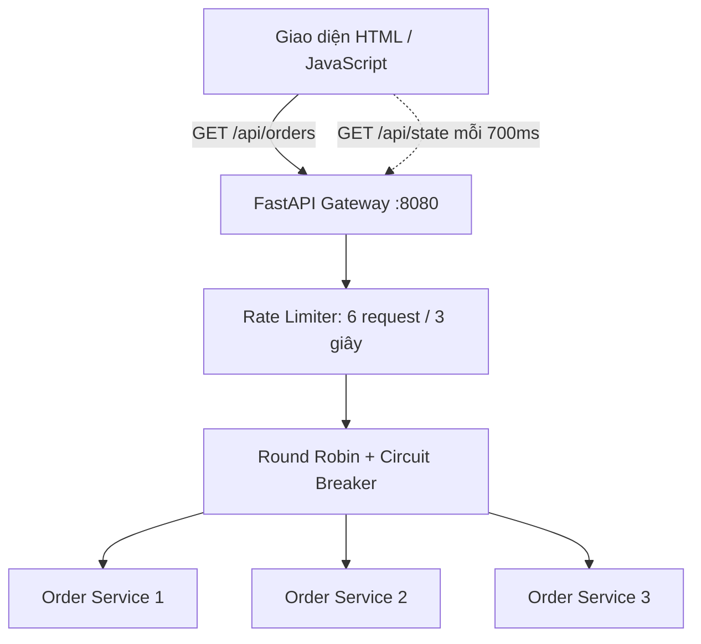

# Gateway Lab — FastAPI

**Bản cập nhật email:** xem [EMAIL_SETUP.md](EMAIL_SETUP.md) để bật cảnh báo, thử gửi và xử lý lỗi SMTP. Mặc định email tắt; cần tự điền `.env` trên máy của bạn.

Bản nâng cấp từ giao diện HTML mô phỏng sang hệ thống HTTP thật. Frontend gọi Gateway; Gateway chuyển request tới một trong ba tiến trình Order Service bằng HTTPX. Service trả dữ liệu đơn hàng mẫu; chưa có cơ sở dữ liệu hoặc nghiệp vụ tạo đơn.

## 1. Chạy nhanh trên Windows

Cần Python 3.11 trở lên. Giải nén, mở terminal trong thư mục `gateway-lab`, chạy:

```powershell
py -m venv .venv
.\.venv\Scripts\python.exe -m pip install -r requirements.txt
.\.venv\Scripts\python.exe run.py
```

Mở **http://127.0.0.1:8080**. Không mở trực tiếp `static/index.html` bằng file explorer.

- Giao diện: http://127.0.0.1:8080
- Swagger của Gateway: http://127.0.0.1:8080/docs
- Ba service: các cổng 9001, 9002, 9003.
- Nhấn Ctrl+C trong terminal để dừng tất cả tiến trình.
- Nếu cổng đã bị chiếm, dừng ứng dụng dùng cổng đó rồi chạy lại.

Linux/macOS:

```bash
python3 -m venv .venv
.venv/bin/python -m pip install -r requirements.txt
.venv/bin/python run.py
```

## 2. Chạy bằng Docker Compose

Cần Docker Engine hoặc Docker Desktop cùng Docker Compose:

```bash
docker compose up --build
```

Mở http://127.0.0.1:8080. Các service nội bộ chạy cổng 9000 trong từng container, chỉ Gateway xuất cổng ra máy chủ. Dừng bằng:

```bash
docker compose down
```

Compose được cung cấp để triển khai cục bộ; không đồng nghĩa ứng dụng đã được đưa lên Internet. Lần khởi động đầu, nếu Gateway sẵn sàng trước service, chờ vài giây rồi gửi lại request.

## 3. Kiến trúc và mã nguồn



| Tệp | Vai trò |
|---|---|
| `app/gateway.py` | Định tuyến, giới hạn tải, circuit breaker, thống kê, nhật ký |
| `app/service.py` | API đơn hàng mẫu, tạo lỗi 500 hoặc độ trễ thật |
| `static/index.html` | Giao diện gọi backend bằng fetch; không tự tính kết quả mô phỏng |
| `run.py` | Khởi chạy và dừng 4 tiến trình Uvicorn |
| `tests/test_integration.py` | Kiểm thử tích hợp qua HTTP thật |
| `compose.yaml` và `Dockerfile` | Đóng gói Gateway và ba service |

HTTPX AsyncClient được tạo/đóng qua FastAPI lifespan để tái sử dụng kết nối. Tham khảo: https://fastapi.tiangolo.com/advanced/events/

## 4. Kịch bản trình bày đồ án

### A. Cân bằng tải

Khởi động hệ thống mới. Bấm “Gửi 1 request” ba lần. Nhật ký lần lượt hiển thị order-service-1, order-service-2, order-service-3 và mã 200. Bấm tiếp để thấy vòng lặp quay lại instance 1.

### B. Giới hạn truy cập

Đợi hơn 3 giây để hết cửa sổ trước. Bấm “Gửi 15 liên tục”. Với service bình thường, 6 request được xử lý, 9 request bị từ chối bằng mã 429. Response 429 có header Retry-After. Giới hạn này áp dụng chung cho tất cả người dùng của Gateway demo, không phải theo IP.

### C. Circuit Breaker

1. Bật “Gây lỗi” trên instance 1.
2. Gửi từng request, quan sát các request tới instance 1 trả mã 500. Tránh vượt 6 request trong 3 giây.
3. Khi instance 1 có 3 lỗi liên tiếp, trạng thái chuyển OPEN; Gateway bỏ qua instance đó và dùng hai instance còn lại.
4. Bấm “Ngừng gây lỗi”. Sau 6 giây tính từ khi OPEN, trạng thái HALF-OPEN cho phép một request dò xét.
5. Gửi thêm request. Khi probe thành công, instance chuyển CLOSED và quay lại vòng cân bằng tải. Nếu vẫn lỗi, probe làm circuit mở lại.

CLOSED là trạng thái của circuit breaker, không phải kết quả health check liên tục. Instance không được tự gọi thử ở HALF-OPEN: phải có request mới đi vào.

### D. Timeout và ngắt service

- Bấm “Chậm 3 giây” trên một instance. Timeout mặc định của Gateway là 2 giây nên request tới instance đó trả mã 504.
- Bấm “Tắt chậm” để trả về 100ms.
- Khi chạy Docker, dùng `docker compose stop order1`, rồi gửi request tới instance 1: nhận mã 502 vì không kết nối được. Dùng `docker compose start order1` để khởi động lại. Circuit phục hồi qua probe như trên.
- Các instance vẫn phục vụ bình thường sẽ tiếp tục nhận request.

### E. Không còn instance khả dụng

Bật lỗi cả ba instance, gửi request vừa đủ dưới giới hạn tải đến khi cả ba OPEN. Request tiếp theo nhận 503 nếu chưa bị Rate Limiter chặn. Tắt lỗi, đợi 6 giây rồi gửi lại để phục hồi.

## 5. API

| Method | Endpoint | Kết quả |
|---|---|---|
| GET | `/` | Giao diện |
| GET | `/health` | Gateway còn chạy; không kiểm tra service phía sau |
| GET | `/api/orders` | Chuyển request đến service, trả mã HTTP thực tế |
| GET | `/api/state` | Thống kê, trạng thái circuit, tối đa 400 sự kiện |
| PUT | `/api/instances/{id}/fault` | Đặt lỗi/độ trễ của instance 0, 1 hoặc 2 |

Body điều khiển: `{"fail": true, "delay_ms": 100}`. Cần header `X-Control-Key`. Mặc định cho demo cục bộ: `local-demo-key`; nhập cùng giá trị vào ô khóa trên giao diện.

Ví dụ PowerShell:

```powershell
Invoke-RestMethod http://127.0.0.1:8080/api/orders
Invoke-RestMethod -Method Put -Uri http://127.0.0.1:8080/api/instances/0/fault -Headers @{"X-Control-Key"="local-demo-key"} -ContentType "application/json" -Body '{"fail":true,"delay_ms":100}'
```

Có thể thử bằng Swagger `/docs`; đây cũng là nơi xem schema request/response.

## 6. Kiểm thử tự động

Windows:

```powershell
.\.venv\Scripts\python.exe -m pytest tests -v
```

Linux/macOS:

```bash
.venv/bin/python -m pytest tests -v
```

Bộ kiểm thử khởi động Gateway và ba service trên các cổng cục bộ trống. Không cần chạy `run.py` trước; không dùng mock HTTP. Test rút ngắn cửa sổ rate limit, thời gian OPEN và timeout qua biến môi trường để chạy nhanh, nhưng dùng cùng mã nguồn với cấu hình demo.

Xem `TEST_RESULTS.md` để biết các kiểm thử đã thực hiện và những phần chưa xác minh.

## 7. Giới hạn và hướng phát triển

- Đây là hệ thống demo triển khai cục bộ với mạng HTTP thật; đơn hàng vẫn là dữ liệu mẫu.
- Gateway dùng bộ nhớ của **một process**. Không chạy nhiều worker/replica khi chưa chuyển rate limit, metrics và circuit state sang kho trạng thái phù hợp.
- Khởi động lại Gateway làm mất nhật ký, bộ đếm và circuit state. Cấu hình gây lỗi thuộc bộ nhớ từng service; để reset toàn bộ demo, khởi động lại cả 4 process/container.
- Không có retry tự động, database, tài khoản đăng nhập hay JWT. Module Auth trên sơ đồ được ghi là “demo công khai”. Chỉ API điều khiển lỗi có khóa.
- Nút xóa nhật ký chỉ xóa phần hiển thị trên trình duyệt hiện tại. Backend vẫn giữ tối đa 400 sự kiện.
- Frontend polling mỗi 700ms; không phải WebSocket. Viền instance đổi màu sau khi nhận response; không thể hiện gói tin ở cấp mạng.
- Trước khi mở ra Internet cần thêm đăng nhập/phân quyền, TLS, khóa riêng, bảo vệ API điều khiển lỗi và giới hạn theo client. Cấu hình đi kèm chỉ bind cổng máy chủ vào localhost.

### Biến môi trường

| Biến | Mặc định | Ý nghĩa |
|---|---|---|
| CONTROL_KEY | local-demo-key | Khóa điều khiển; phải giống nhau ở Gateway và service |
| SERVICE_URLS | http://127.0.0.1:9001,...,9003 | Danh sách địa chỉ backend, cách nhau bằng dấu phẩy |
| RATE_WINDOW | 3 | Cửa sổ giới hạn 6 request, đơn vị giây |
| BREAKER_TIMEOUT | 6 | Thời gian giữ OPEN, giây |
| UPSTREAM_TIMEOUT | 2 | Timeout HTTP tới service, giây |
| INSTANCE_NAME | order-service-1 | Tên instance trả về trong response |
